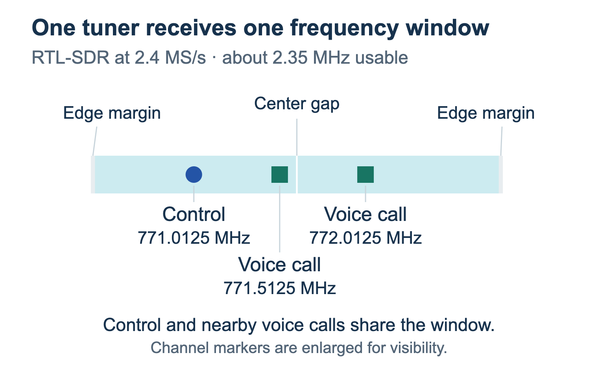
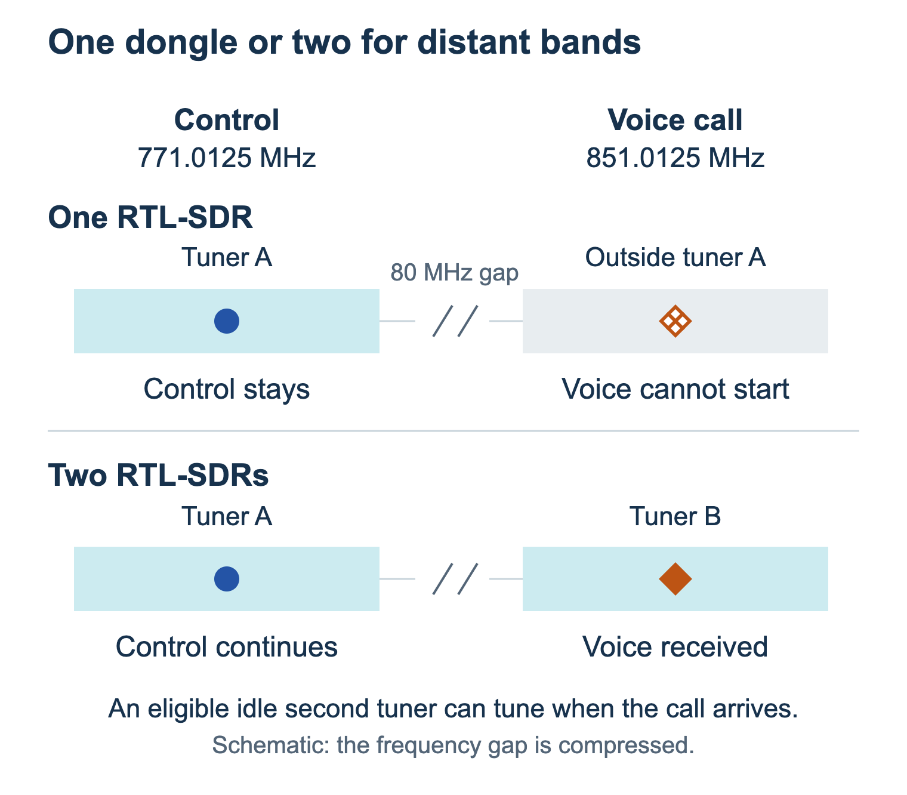
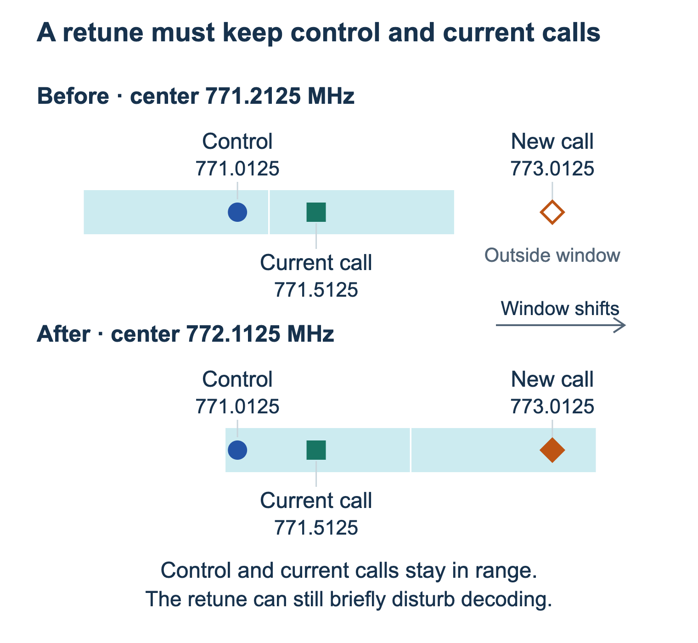
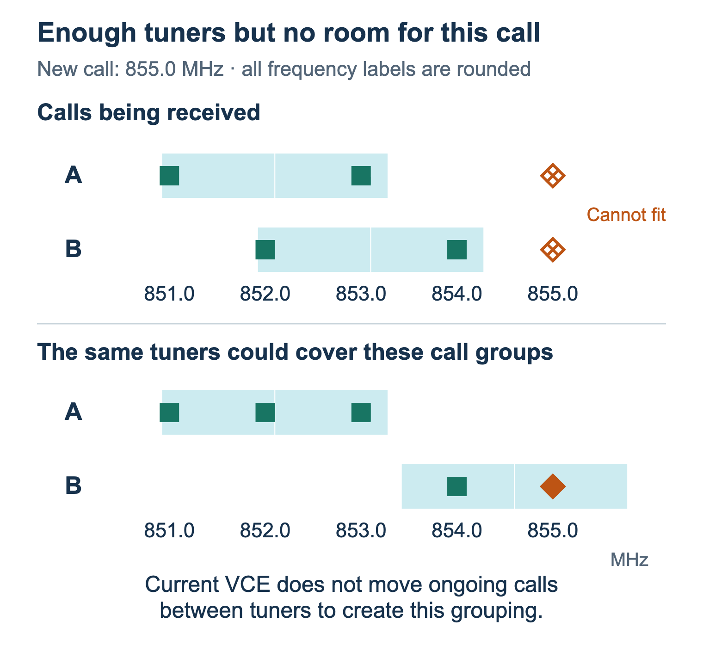

# How VCE uses your tuners

Each SDR receives one window of frequencies. Calls can share it, but settings and channels already being received
determine whether the next call fits.

For **current Nightly**; Alpha versions may differ. Diagrams use made-up frequencies, R820T-family RTL-SDRs
at **2.4 MS/s**, and **12.5 kHz channels**.

## One tuner, one receiving window

*Several nearby calls can share one tuner.*

A tuner's **tuning range** says where it can move; **bandwidth** says how much it receives at once.
An RTL-SDR can tune to 700 or 800 MHz while receiving about **2.35 MHz** at a time.

**Center frequency** sets the window's position; **sample rate** sets its nominal width. VCE excludes weak
edges and sometimes a small center area. The whole channel must fit. Adding decoders does not widen the window.

## How VCE finds room for a call

**Conventional channels and trunking control channels need bandwidth immediately available before they can
start.** Existing coverage or an allowed startup retune can supply it. If neither works, the channel cannot start.

When control announces a voice call, VCE tries these choices in order:

1. **Current window:** use a ready tuner already covering the call's frequency.
2. **Unused tuner:** move an available tuner that is receiving no calls or running channels.
3. **Tuner already in use:** shift an unlocked tuner only if the new call, ongoing calls, control channel, and
   running conventional channels all still fit.

If none works, the new call cannot start. VCE does not drop existing calls or tune away from active control to
follow an incompatible request.

**Preferred Tuner** comes first within each step; it does not reserve hardware or override limits and locks.
P25 voice calls follow the control channel's preference. Among other tuners already covering a call, VCE favors
one already in use, then the one whose received frequencies stay closest together. This keeps spare tuners free.

When an unused tuner needs to move, VCE also considers known frequencies that other tuners do not cover.
The new call must still fit. A supplied control-frequency group or working range can guide initial tuning.

## One dongle versus two

*A spare tuner can receive voice while the first tuner keeps control.*

One dongle cannot receive both together. A ready unused second dongle can tune for voice immediately.

Calls at **851.0125, 851.5125, and 852.0125 MHz** can share that second tuner. Another simultaneous call at
**855.0125 MHz** cannot fit with them. After earlier calls end, that tuner may move for a later call.
A center lock near 771 MHz or limits excluding 851 MHz would prevent the second tuner from helping.

## Retuning keeps existing channels in range

*A tuner can move if control and calls already being received still fit.*

VCE checks other current windows and unused tuners first. Moving an in-use tuner requires **Lock center** off
and every ongoing call, control channel, and running conventional channel to remain inside the new window.

Retuning can briefly disturb reception or audio even while control stays within range. VCE does not start a second
control receiver before moving the original. Trying an alternate control frequency can also leave a reception gap.

## Enough hardware, but the next call does not fit

*Enough bandwidth on paper does not mean a new call fits with the ongoing calls.*

VCE does not move ongoing calls between dongles. When a tuner becomes unused, VCE can move its center to cover
more known frequencies. It moves only when overall known coverage improves, without losing known frequencies
covered elsewhere. Locked tuners and tuners still receiving channels stay in place.

This reduces wasted overlap as calls end. It cannot guarantee every simultaneous call will fit.

## Settings to check

Open **Hardware > Tuners** and select a tuner.

| Control | Effect |
| --- | --- |
| **Live** | Available to receive channels when otherwise ready. |
| **Setup** | Running for adjustment; unavailable to ordinary receiver channels. |
| **Disabled** | Not used for reception. |
| **Sample rate** | Changes the window's width. |
| **Lock center**, under **Tuning** | Keeps the window fixed when starting channels or calls. Outside calls cannot use it. |
| **Minimum frequency / Maximum frequency**, under **Common tuning > Frequency limits** | Restrict allowed channels and centers, in MHz. They do not widen the window or reserve a site. |

Under **Manage > Channels > Edit > Source**, **Preferred Tuner** changes selection order.
**Minimum working frequency / Maximum working frequency** describe the channel's broader working range,
separately from tuner limits. A range that fits can guide initial tuning; a wider range does not automatically
split across dongles. For P25, a voice frequency outside that saved range is rejected before VCE tries a tuner.

Locked centers can stabilize a suitable layout, but cannot fill coverage gaps. Check channel edges, center
exclusions, and known alternate control frequencies before relying on fixed windows.

## Shared tuners and newly discovered frequencies

Sites share the tuners. Running conventional channels use them even when quiet. Other activity changes what fits.

Voice frequencies may appear hours or days apart. VCE tries valid calls immediately; it does not wait for a complete
list. New frequencies become hints for later placement, including when a tuner becomes unused. For P25, VCE
also uses frequencies confirmed for the currently received site. Quiet periods cannot prove discovery is finished.

**Known coverage** means coverage of those frequencies, not proof that every frequency the system may use is
covered. A newly announced frequency can still be received immediately if a current window or allowed retune fits.

## Failures and missing audio

| What you see | What to check |
| --- | --- |
| Tuner unavailable / channel start rejected | Tuner states, current windows, ongoing calls and running channels, locks, frequency limits, or a temporarily busy tuner. |
| P25 frequency outside working range | The channel's working-frequency settings. |
| **MAX TRAFFIC CHANNELS EXCEEDED** | **Manage > Channels > Edit > Decoder > Maximum traffic channels**. More decoder slots do not widen RF coverage. |
| Detected call without audio | Control may have heard the grant while starting or decoding voice failed. |

Open **Administration > Status & support > Receiver status** for active and recent alerts, or **Report a problem**
to collect a support report. Record the failure's time, frequency, tuner settings, and calls and channels being
received. Remove credentials and personal information before posting logs publicly.

Open **Administration > Decisions engine > Tuner allocation** to see each site's known coverage and each tuner's
current work and receiving window. **Call matching** is in the same group.

The tuner decision history records automatic moves and failed attempts, with a short reason. Repeated failures are
grouped; ordinary successful calls do not create rows. A move's details show its original before-and-after windows,
even if the tuner moves again. Current site details show the latest windows. **Pause** freezes the display while
receiving continues. History is held in memory, is limited, and clears when VCE restarts.

Failed-start counters cover control, conventional, and voice requests. Repeated attempts can increase them;
they do not count unique missed calls. A successful start or clear status page does not prove every call decoded.

## Further reading

- [Center Frequency Planner](../tools/sdrtrunk-center-frequency-calculator.html): download and open the HTML to
  compare frequency groups. It does not apply settings or account for calls currently being received.
- [Browser listening and Scan Lists](browser-listening-and-scan-lists.md): listener choices do not change tuner coverage.
- [Upstream tuner guide](https://github.com/DSheirer/sdrtrunk/wiki/Tuners) and
  [allocation FAQ](https://github.com/DSheirer/sdrtrunk/wiki/FAQ#unable-to-source-channel-from-preferred-tuner):
  background concepts; upstream controls and tuner selection may differ.
